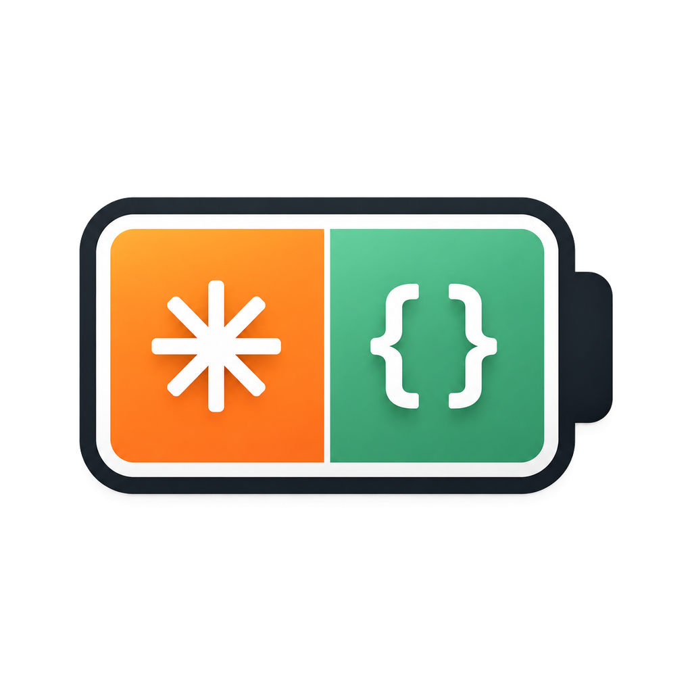
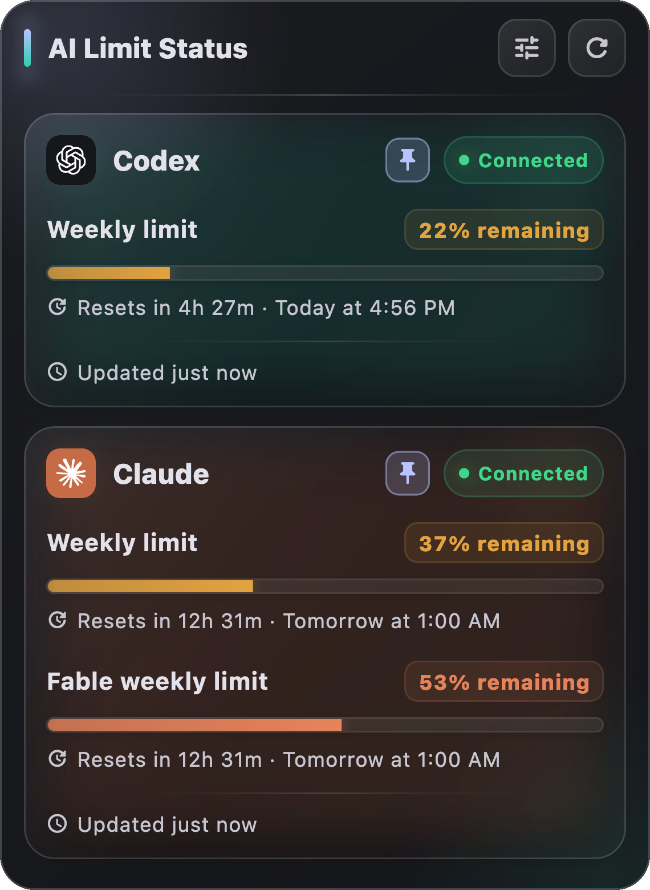

<p align="center">
  
</p>

<h1 align="center">AI Limit Status</h1>

<p align="center">
  Monitor Codex, Claude, and Antigravity usage limits from your macOS menu bar
  or Windows taskbar.
</p>

<p align="center">
  <a href="https://github.com/farhans-codes/ai_limit_status/releases/latest"></a>
  <a href="https://github.com/farhans-codes/ai_limit_status/actions/workflows/ci.yml"></a>
  <a href="LICENSE"></a>
  
</p>

AI Limit Status is a lightweight, open-source Flutter desktop companion that
keeps subscription usage visible without interrupting your workflow. It uses
the macOS menu bar and an experimental Windows taskbar overlay, refreshes
connected providers automatically, and does not include analytics or telemetry.

> [!IMPORTANT]
> AI Limit Status is an independent community project. It is not affiliated
> with, endorsed by, or sponsored by OpenAI, Anthropic, or Google.

## Supported providers

| Provider | macOS | Windows | How usage is read |
|---|---|---|---|
| Codex | Yes | Yes | Your Codex CLI sign-in |
| Claude | Yes | Yes | Your Claude Code sign-in |
| Antigravity | Yes | Older Antigravity versions only, untested | The running Antigravity app |

More providers are planned and open for contribution. If you use Cursor,
Copilot, Gemini, OpenRouter, or another AI tool and want it here, see
[Adding a provider](docs/adding-a-provider.md): one reader class and a few
lines of registration.

## Screenshots

### Always in your menu bar

<p align="center">
  
</p>

<p align="center"><sub>Your remaining limits stay in the macOS menu bar, or on the Windows taskbar, while you work.</sub></p>

### One click for the details

<p align="center">
  
</p>

<p align="center"><sub>Every limit with its reset time. The pin on each card keeps that provider in the menu bar.</sub></p>

## Download

| Platform | Recommended | Alternative |
| --- | --- | --- |
| macOS | [Download DMG](https://github.com/farhans-codes/ai_limit_status/releases/latest/download/AI-Limit-Status-macOS.dmg) | [Download ZIP](https://github.com/farhans-codes/ai_limit_status/releases/latest/download/AI-Limit-Status-macOS.zip) |
| Windows x64 | [Download Setup EXE](https://github.com/farhans-codes/ai_limit_status/releases/latest/download/AI-Limit-Status-Windows-x64-Setup.exe) | [Download portable ZIP](https://github.com/farhans-codes/ai_limit_status/releases/latest/download/AI-Limit-Status-Windows-x64-portable.zip) |

On macOS you can also install it with [Homebrew](https://brew.sh):

```bash
brew install --cask farhans-codes/tap/ai-limit-status
```

[View the latest release notes](https://github.com/farhans-codes/ai_limit_status/releases/latest)
or [download SHA-256 checksums](https://github.com/farhans-codes/ai_limit_status/releases/latest/download/AI-Limit-Status-SHA256SUMS.txt).

## Features

- Shows only providers available through an installed CLI or existing provider
  credentials on the current computer.
- Displays available Codex usage windows and Claude's weekly, Fable, Opus, and
  Sonnet allowances, including weekly-only Ultra usage.
- Displays Antigravity's weekly and five-hour limits for its Gemini and
  Claude/GPT model groups while the Antigravity app is open.
- Lets users choose whether the Claude shortcut shows the overall weekly or Fable
  weekly limit.
- Keeps each provider's percentage visible in the macOS menu bar or side by
  side in the Windows taskbar. A pin on each provider card chooses which
  ones appear there, up to three at a time.
- Shows the Windows taskbar indicators on a transparent, fully clickable
  status surface, including the space between each icon and percentage.
- Keeps the Windows details window open during taskbar and notification-area
  interactions, while genuine outside clicks still dismiss it.
- Refreshes every connected provider automatically every two minutes.
- Opens a compact glass-style details window from the menu-bar or taskbar
  shortcut.
- Plays a bundled custom chime for usage warnings and reset notifications.
- Sends each notification only once per threshold and reset window.
- Offers guided installation and sign-in actions where the platform supports
  them.
- Can launch automatically when the user signs in.
- Keeps the last successful percentage and reset-time snapshot during temporary
  provider or network failures.
- Uses a single English interface across supported platforms.
- Does not include analytics, advertising, or telemetry.

## Status shortcut preference

Open **App settings** to choose the Claude value shown in the macOS menu bar or
Windows taskbar:

- **Weekly limit** shows the overall Claude weekly allowance (the default).
- **Fable weekly limit** shows the scoped Fable allowance reported by Claude.

Other pinned providers remain visible beside the selected Claude value. If Claude
does not report the selected limit, the shortcut shows `—` instead of silently
substituting a different limit.

Existing five-hour shortcut preferences automatically use the overall weekly
limit. Claude's retired five-hour window is ignored in live and cached usage.
Usage is read from the provider without depending on the subscription plan name.

## Notification rules

Usage notifications play the bundled AI Limit Status chime and apply to both
providers:

- 50% remaining: use the remaining allowance carefully.
- 20% remaining: an extra-caution warning.
- 10% remaining: a warning to reduce usage.

Claude and Codex weekly notifications:

- Weekly limit restored.
- One day before reset.
- 12 hours before reset.
- Five hours before reset.
- One hour before reset.

Five-hour restored or countdown notifications are not sent. Each
notification is shown only once for a specific reset window.

## Install and first launch

### macOS

1. Download the macOS DMG.
2. Open it and drag **AI Limit Status** into **Applications**.
3. Open the app from Applications.

When Claude's OAuth usage endpoint is unavailable, the macOS app can read the
existing `claude.ai` session cookie from a supported browser and may request
browser Keychain or Full Disk Access permission. The cookie remains in app
memory and is used only with Claude-owned endpoints.

If both Codex OAuth and its local app-server are unavailable, the same macOS
fallback can use the existing `chatgpt.com` browser session. Browser credentials
remain in app memory and are sent only to their provider-owned endpoint.

Public beta builds may not yet be notarized. If Gatekeeper blocks a verified
GitHub release, Control-click the app, choose **Open**, and confirm once. Never
run a copy downloaded from an untrusted source.

### Windows

1. Download the Windows x64 Setup EXE.
2. Run the installer and follow the setup wizard.
3. Open AI Limit Status from the Start menu.

The live Codex and Claude indicators appear together in the taskbar immediately
to the left of the Windows notification area. Left-click the indicators to open
the details window, or right-click them to open the app menu. The Claude value
can be changed between the overall weekly and Fable weekly limits from **App
settings**.

Unsigned public beta builds can trigger Microsoft Defender SmartScreen. Verify
the release checksum and GitHub source before continuing. The installer bundles
the Visual C++ runtime files required by Flutter, so users do not need to install
them separately.

The portable ZIP is also available for users who do not want an installer.
Extract the entire ZIP into a normal folder before opening
`ai_limit_status.exe`; running the executable from inside the compressed archive
prevents Windows from loading the bundled Flutter and Visual C++ DLLs.

### Connecting Claude

Claude works exactly like Codex: the app reads the sign-in created by the
provider CLI. If Claude Code is not installed (or not signed in) on the PC, the
Claude card stays visible and offers **Install & sign in**, which installs
`Anthropic.ClaudeCode` through WinGet and starts `claude auth login`. After
that one-time sign-in the app keeps the token fresh itself.

Use the pin on a provider's card to keep it in the status shortcut or take it
out. The shortcut shows up to three providers; unpinned providers stay in the
details window.

### Optional Windows browser fallback

If a provider's CLI session cannot return usage, Windows users can opt in to
the bundled browser bridge. It reads only the signed-in `chatgpt.com` and
`claude.ai` cookies and keeps them in memory while requesting usage from the
same provider.

For Chrome or Edge, open the browser's Extensions page, enable **Developer
mode**, choose **Load unpacked**, and select:

```text
%LOCALAPPDATA%\Programs\AI Limit Status\browser_extension\chromium
```

The Setup EXE registers the local bridge automatically. Portable ZIP users
must first run:

```powershell
powershell -ExecutionPolicy Bypass -File ".\browser_bridge\register_native_host.ps1"
```

Firefox source is bundled under `browser_extension/firefox`; a signed Firefox
add-on is required for permanent installation outside development mode.

## Provider setup

Each provider is independent. Users only need to connect the services they
already use.

On Windows, **Install & sign in** uses the official WinGet packages
`OpenAI.Codex` and `Anthropic.ClaudeCode`, starts the provider-owned sign-in
flow, and checks the connection again.

On macOS, install the provider from the official
[Codex CLI](https://developers.openai.com/codex/cli/) or
[Claude Code](https://code.claude.com/docs/en/getting-started) guide. The app
detects common native, Homebrew, npm, and application-bundled CLI locations.

Antigravity needs no setup: open the Antigravity app (or Antigravity IDE) and
its limits appear. They are read from the app's own local server on this
computer, so the last reading is shown as cached while the app is closed.
Antigravity gets no card on computers where it is not installed.

AI Limit Status does not ask users to paste an API key into the app.

## Privacy and credential handling

- Codex usage normally uses the existing provider-owned `auth.json` file under
  `CODEX_HOME` or the user's `.codex` directory, then requests usage from
  `https://chatgpt.com/backend-api/wham/usage`. The local `codex app-server`
  remains a fallback.
- Shortly before a Codex token expires, AI Limit Status may refresh it through
  `https://auth.openai.com/oauth/token` and write the rotated credential back
  to the same provider-owned `auth.json` file so the Codex CLI stays in sync.
  Codex tokens are not stored in AI Limit Status cache, settings, or logs.
- On macOS, or on Windows with the optional browser bridge, if OAuth and the
  local Codex app-server are both unavailable, the app can import the existing
  `chatgpt.com` browser session and request usage from
  `https://chatgpt.com/backend-api/wham/usage`. Browser cookies are not written
  to AI Limit Status cache, settings, or logs.
- Claude usage requires the existing Claude Code OAuth credential. On macOS,
  the app reads it from the `Claude Code-credentials` Keychain entry. On
  Windows, it reads the provider-owned `.claude/.credentials.json` file.
- Shortly before a file-backed Claude token expires, AI Limit Status may
  refresh it through `https://platform.claude.com/v1/oauth/token` with Claude
  Code's own OAuth client and write the rotated credential back to the same
  `.credentials.json` file so the Claude CLI stays in sync. Keychain-held
  credentials are never rewritten.
- If Claude rejects a saved login, the app rereads the provider-owned
  credential and retries once when it has changed. If a secure-store login
  still needs renewal, the Claude card shows **Sign in**. Complete that
  provider-owned login to reconnect without restarting the app. A previous
  credential's rate-limit cooldown does not block the new login.
- The Claude access token is held in memory only long enough to request usage
  from `https://api.anthropic.com/api/oauth/usage`. AI Limit Status does not
  write the token to its own files or logs.
- On macOS, or on Windows with the optional browser bridge, if that endpoint is
  unavailable, the app can import the existing `claude.ai` `sessionKey` from a
  supported browser and request usage from `https://claude.ai/api`. The session
  key is not written to AI Limit Status cache, settings, or logs.
- Local cache files contain only remaining percentages, reset timestamps, and
  the last successful update time. A small diagnostic log
  (`logs/app.log`, never uploaded) records window and provider events without
  tokens or usage payloads; attach it to bug reports.
- No usage data is sent to the project maintainer or any analytics service.

Read the complete [privacy statement](PRIVACY.md) and
[security policy](SECURITY.md) before installing the app.

## Troubleshooting

### Claude or Codex shows "—", "Cached", or asks you to sign in again

Check whether more than one copy of the provider CLI is installed. An old copy
(for example a Homebrew or npm install next to the native installer) can be
picked up instead of the one your terminal uses.

On macOS:

```bash
which -a claude
which -a codex
```

On Windows (PowerShell):

```powershell
where.exe claude
where.exe codex
```

If a command lists more than one path, keep the one your terminal uses (the
first line) and uninstall the others, then quit and reopen AI Limit Status. To
pin a specific copy instead, set `CLAUDE_CLI_PATH` or `CODEX_CLI_PATH` to its
full path.

The app log shows which step failed:

- macOS: `~/Library/Logs/AI Limit Status/app.log`
- Windows: `%LOCALAPPDATA%\AI Limit Status\logs\app.log`

## FAQ

### How do I check my Claude Code usage limit?

Install AI Limit Status and sign in to Claude Code once with `claude`. The
remaining weekly limit, and any model-specific weekly limit such as Opus or
Sonnet, appears in the macOS menu bar or the Windows taskbar, with the exact
reset time in the popover.

### How do I see how much of my Codex weekly limit is left?

Sign in to the Codex CLI with `codex login`. AI Limit Status shows the
remaining percentage of the Codex weekly limit and when it resets, next to
Claude if you use both.

### When does my Claude or Codex limit reset?

Each card in the popover shows the reset as a countdown plus the local day and
time, for example "Resets in 2d 16h · Fri, Nov 20 at 1:00 AM".

### Can I get a warning before I run out?

Yes. AI Limit Status sends a desktop notification when a limit drops to 50%,
20% and 10%, and reminders before it resets. Turn them off in Settings.

### Is there a CodexBar alternative for Windows?

AI Limit Status runs on both macOS and Windows and shows Codex and Claude
limits side by side. [CodexBar](https://github.com/steipete/CodexBar), a
similar menu bar tool, is macOS-only.

### Does it need an API key or send my data anywhere?

No. It reuses the sign-in your Claude Code and Codex CLIs already created, asks
the providers for your usage directly, and has no analytics or telemetry. See
[Privacy and credential handling](#privacy-and-credential-handling).

## Known limitations

- Provider CLIs and usage endpoints can change without notice and temporarily
  break usage detection.
- Antigravity usage comes from an internal, undocumented local server. It is
  only available while Antigravity is open, and Antigravity 2.35 and later can
  currently be read on macOS only.
- Direct browser-cookie fallback requires macOS 13 or newer. Windows requires
  the bundled opt-in extension; marketplace publication is still pending.
- The Windows taskbar status is an experimental overlay because Windows 11 does
  not provide a supported API for embedding two live custom indicators in the
  taskbar. It currently targets the primary taskbar; Windows Shell updates or
  third-party taskbar replacements can affect its position.
- Code signing and notarization status can differ between releases; always read
  the release notes.
- Windows release builds currently target x64-compatible systems.

## Build from source

Requirements:

- Flutter `3.44.2` or a compatible stable release.
- Xcode command-line tools for macOS builds.
- Visual Studio with **Desktop development with C++** for Windows builds.
- The provider CLIs needed for initial sign-in and fallback usage detection.

```bash
flutter pub get
flutter analyze
```

Build on the target operating system:

```bash
# macOS
flutter build macos --release

# Windows, from Windows
flutter build windows --release
```

Windows builds cannot be produced directly from macOS. Maintainers can use the
included GitHub Actions workflows for reproducible platform builds.

## Contributing

Contributions are welcome, and new AI providers most of all: see
[Adding a provider](docs/adding-a-provider.md).

Read [CONTRIBUTING.md](CONTRIBUTING.md), follow the
[Code of Conduct](CODE_OF_CONDUCT.md), and use the repository issue templates
before opening a pull request.

Security vulnerabilities must not be posted in public issues. Follow
[SECURITY.md](SECURITY.md) instead.

## Acknowledgements

This project was independently conceived and developed by the author.

The Antigravity reader follows the local-server approach documented by
[CodexBar](https://github.com/steipete/CodexBar) (MIT).

Special thanks to my colleagues and mentors for their valuable ideas,
feedback, and suggestions throughout different stages of the project. Their
guidance has helped improve the project in many ways.

## License and trademarks

The source code is available under the [MIT License](LICENSE).

OpenAI, Codex, Anthropic, Claude, and their logos are trademarks of their
respective owners. The MIT License does not grant rights to third-party names,
logos, or marks. See [NOTICE.md](NOTICE.md).
